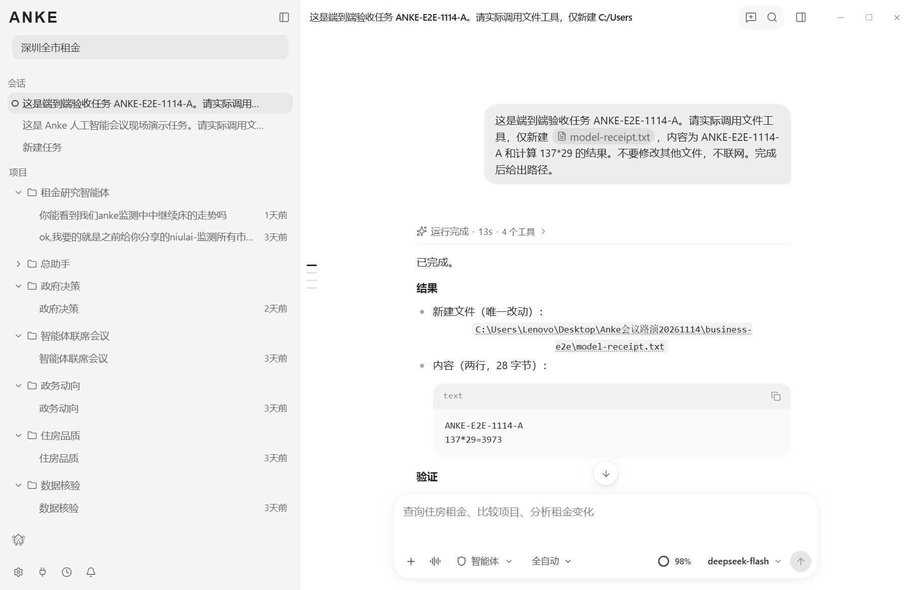
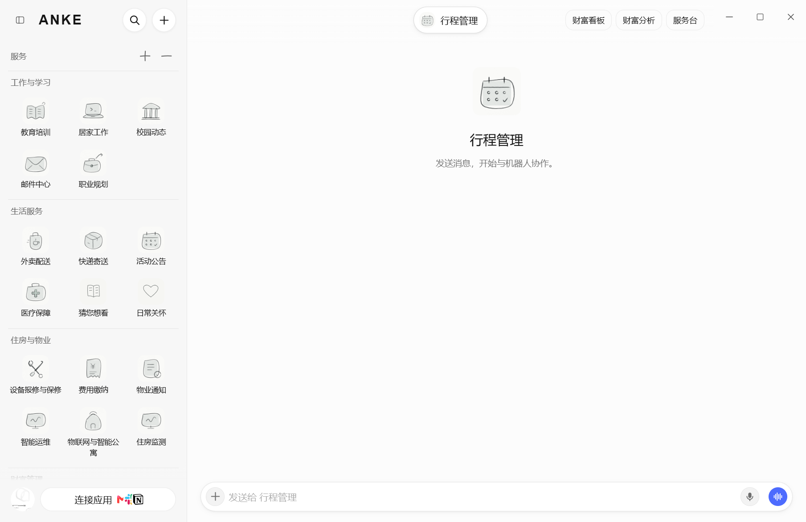

# ANKE

[简体中文](README.zh-CN.md) | English

**Your personal assistant for life and work** — a local-first desktop workspace connecting housing evidence, rental research, everyday services, lifelong learning and AI assistants.

Technology serves life. Life comes first. Understand your choices, keep sight of the evidence, and decide what happens next.

ANKE's project home is [sjkncs/Anke](https://github.com/sjkncs/Anke). It adapts PI-Desktop with upstream attribution retained; it is not an official PI-Desktop or World Monitor distribution.

[](LICENSE)
[](https://www.typescriptlang.org/)
[](https://www.rust-lang.org/)
[](https://github.com/sjkncs/Anke/releases/tag/anke-2026.11.15-preview)

<p align="center">
  <a href="https://github.com/sjkncs/Anke/releases/tag/anke-2026.11.15-preview"><strong>Download Preview Assets</strong></a> &nbsp;·&nbsp;
  <a href="https://github.com/sjkncs/Anke/tree/6b1b539/anke-website"><strong>Website &amp; Experience</strong></a> &nbsp;·&nbsp;
  <a href="https://github.com/sjkncs/Anke/tree/6b1b539/config/local-presets"><strong>Bot &amp; Model Presets</strong></a>
</p>

<p align="center">
  <a href="docs/spec/06-delivery/anke-releases-and-cloud.md"><strong>Documentation</strong></a> &nbsp;·&nbsp;
  <a href="https://github.com/sjkncs/Anke/releases"><strong>Releases</strong></a> &nbsp;·&nbsp;
  <a href="CONTRIBUTING.md"><strong>Contributing</strong></a>
</p>



*ANKE Agent interface captured from the local preview. Downloads require access to this private repository.*

## Ways to Use It

| Surface | Get it | Docs |
| --- | --- | --- |
| Desktop source | Electron, React and Rust host | [Quick Start](#quick-start) |
| Latest local snapshot | [2026.11.15 preview](https://github.com/sjkncs/Anke/releases/tag/anke-2026.11.15-preview), commit `6b1b539` | [Validation](https://github.com/sjkncs/Anke/blob/6b1b539/config/local-presets/VALIDATION.md) |
| Website experience | `ANKE-website-20261115.zip` in the release | [Source](https://github.com/sjkncs/Anke/tree/6b1b539/anke-website) |
| Bots and workspaces | `ANKE-presets-sanitized-20261115.zip` | [Restore limitations](https://github.com/sjkncs/Anke/blob/6b1b539/config/local-presets/README.md) |
| Housing companion services | Local services in this repository | [Housing](talent-housing/README.md) · [Rental knowledge](rent-knowledge/README.md) |
| Roadshow | `ANKE-roadshow-20261115.zip`, video and subtitles | [Release assets](https://github.com/sjkncs/Anke/releases/tag/anke-2026.11.15-preview) |

The preview provides source and resources, **not a Windows EXE installer**. No published ANKE npm package, public hosted app or public ANKE MCP endpoint is claimed. Downloads require repository access.



---

## What It Does

- **Personal assistants and teams** — Bot roles, instructions, model bindings, collaboration rooms and workspaces.
- **Housing choices** — government/university homes, candidate preferences, project comparison and application/work-order workflows.
- **Rental evidence** — source-tagged observations, filters, comparisons, rental scenarios and geospatial tools; listings and transactions remain distinct.
- **News and policy reading** — registered sources, preserved provenance, event snapshots and evidence-linked reading.
- **Wealth workspace** — financial data and visualization modules in the latest snapshot; provider access requires account entitlements and credentials.
- **Work and daily life** — categorized services, learning/research, wellbeing, shopping and travel workspaces in the latest snapshot.
- **Model and connector settings** — provider catalogs, model selection and separately authorized connectors.
- **Local-first architecture** — desktop UI, native persistence and agent runtime retain separate process boundaries.

The [latest snapshot](https://github.com/sjkncs/Anke/tree/6b1b539) includes additions not yet merged into `main`. Source availability, a visible service entry and successful external execution are separate states. See [Support Status](#support-status).

---

## Support Status

| Surface | Status | Notes |
| --- | --- | --- |
| `main` | Source baseline | Homepage documentation; not the complete latest local snapshot |
| `anke-2026.11.15-preview` | Published prerelease | Source, sanitized presets, website and roadshow, fixed to `6b1b539` |
| Windows / macOS / Linux installers | Not provided in this release | Inherited build targets do not establish shipped binaries or clean-machine acceptance |
| Preset restoration | Snapshot only | 38 Bots, 5 rooms, 10 workspaces, 2 providers and 15 model entries; no automatic importer |
| Model, data and ordering connectors | Requires setup and testing | Credentials excluded; Luckin/McDonald's Bot HTTP records included; standalone MCP server files found: 0 |
| Full application acceptance | Incomplete | Targeted checks passed; rental fixture and formatting checks have documented failures |

Bot, attachment and streaming checks passed **25/25**. With rental tests included, **29/34** passed; five require demo records absent from the repository. See [validation details](https://github.com/sjkncs/Anke/blob/6b1b539/config/local-presets/VALIDATION.md). These results do not establish external API delivery or cross-machine operation.

---

## Quick Start

**Preview downloads:** choose a source/resource package from [Releases](https://github.com/sjkncs/Anke/releases/tag/anke-2026.11.15-preview) and verify `SHA256SUMS.txt`. Presets are a backup format: do not overwrite a live database or `team.json`. Supply your own credentials and valid machine paths.

**Local development:** use Node.js 24 (manifest minimum: 22.19.0), the pnpm version pinned in `package.json`, Rust stable and platform prerequisites for Electron/native dependencies. Review dependency build hooks before installation.

```sh
git clone https://github.com/sjkncs/Anke.git
cd Anke
git switch --detach anke-2026.11.15-preview
pnpm install --frozen-lockfile
pnpm build:js
pnpm build:host
pnpm dev
```

The tag selects the latest published snapshot; omitting that step selects the older `main` baseline. These development instructions are not an accepted one-command installer.

Optional companion services use separate runtimes. Review their README files, data permissions and provider requirements first:

```sh
npm --prefix rent-knowledge ci
node talent-housing/server.mjs
python event-monitor/monitor.py --serve
```

In the tagged source, run `node anke-website/serve.cjs` and open `http://127.0.0.1:47845` for the website preview. The separate website archive includes the roadshow video; the source snapshot does not. A preview server is not a production deployment.

---

## Tech Stack

| Category | Technologies |
| --- | --- |
| Frontend | TypeScript, React, Vite and shared desktop styles |
| Desktop | Electron, native integrations and Rust host core |
| Agent runtime | Node.js/TypeScript sidecar, provider adapters, plugin SDK and devkit |
| Local storage | SQLite and host-managed persistence/credential boundaries |
| Housing data | Node.js/Python tools, PostgreSQL/PGlite and optional geospatial dependencies |
| Website | HTML, CSS and JavaScript with separate media packages |
| Verification | pnpm workspaces, Cargo, Node tests and desktop/E2E scripts |

Source map: [`apps/desktop`](apps/desktop), [`packages`](packages), [`crates/host-core`](crates/host-core), [`rent-knowledge`](rent-knowledge), [`event-monitor`](event-monitor), [`talent-housing`](talent-housing), [`scripts`](scripts) and [`docs`](docs).

---

## Programmatic Access

- **Plugin SDK and tools** — [`plugin-sdk`](packages/plugin-sdk), [`plugin-devkit`](packages/plugin-devkit) and [plugin contracts](docs/spec/07-plugins), with explicit permissions and host-owned interfaces.
- **Local housing services** — [housing workbench](talent-housing/README.md) and [rental knowledge](rent-knowledge/README.md), each with its own setup requirements.
- **Model providers** — configure accounts in the app; the snapshot preserves bindings without account secrets.
- **MCP and Bot connectors** — authorize each service separately. Luckin and McDonald's Bot HTTP records do not imply a public ANKE MCP server or verified ordering/payment execution.

No maintainer token, private OAuth session or personal API balance is distributed. Configuration is not authentication, quota availability or an external-action receipt.

---

## Housing Data

Housing workflows connect candidate needs, available homes, neighborhood context and rent evidence. Quality-adjusted rent analysis must treat housing characteristics, household affordability and policy eligibility separately.

Coordinates, building footprints, roads, remote sensing and streetscape segmentation need source, date, coordinate-system and validation records. A map overlay or model output alone cannot establish structural safety, school admission rights, live congestion or a verified defect.

Bundled rental records start empty. Raw databases, restricted imagery, model weights and research archives are excluded. See [data boundaries](rent-knowledge/README.md).

---

## Supported By

ANKE builds on PI-Desktop and its dependency ecosystem. Attribution is preserved in [source notes](ANJU_SOURCE_NOTES.md), [LICENSE](LICENSE) and plugin notices. No commercial sponsor, hosting sponsorship or third-party endorsement is claimed.

---

## Data Sources

| Source family | Use | Availability boundary |
| --- | --- | --- |
| Housing policy and notices | Eligibility explanations and source-linked consultation | Check version/effective dates; no official approval implied |
| Permitted rental observations | Comparable rents and project analysis | Keep listings, transactions, guidance prices and public rents distinct |
| Registered news sources | Events and policy reading | Access/freshness vary; collection is not verification of event outcomes |
| Findesk and financial providers | Wealth research and charts | User credentials, entitlement, quota and provider availability apply |
| Spatial and image data | Neighborhood analysis and segmentation | Licensing, registration, imagery dates and independent validation required |
| User-supplied knowledge | Local search and research workflows | Private material and accounts are not redistributed |

Unavailable values stay missing. Source access does not imply redistribution rights, complete history or real-time coverage.

---

## Contributing

Read [CONTRIBUTING.md](CONTRIBUTING.md) and [AGENTS.md](AGENTS.md). Keep changes focused, preserve user data and provide reproducible checks. Contributions to this private repository require access.

```sh
pnpm --filter @pi-desktop/desktop typecheck
node --test apps/desktop/test/anke-release-config.test.mjs
```

These are available commands, not a claim that the full application suite ran for this documentation change. See the [baseline checkpoint](docs/spec/06-delivery/anke-verification-2026-11-12.md) and [release/cloud contract](docs/spec/06-delivery/anke-releases-and-cloud.md).

---

## License

The desktop baseline is **LGPL-3.0-or-later**; see [LICENSE](LICENSE) and [source notes](ANJU_SOURCE_NOTES.md). The bundled Bot retains **Apache-2.0** terms. Dependencies, plugins, media and datasets retain their own applicable licenses.

| Use case | Applicable terms |
| --- | --- |
| Personal, research or educational | Follow applicable code and data licenses |
| Modification and redistribution | Preserve notices and satisfy relevant source/distribution obligations |
| Commercial deployment | Review LGPL and each component's terms; no blanket proprietary license granted |
| Credentials, private records and third-party data | Separate authorization required; not granted by the code license |
| ANKE or upstream branding | Code availability alone does not grant trademark or endorsement rights |

README organization references [World Monitor](https://github.com/koala73/worldmonitor/blob/d3f85f8c9cfeece8f3b4f9adf351b6ad1f66b1b4/README.md), inspected 2026-11-15. ANKE's wording, features and licensing are independent; World Monitor's AGPL terms are not substituted for ANKE's license.

---

## Author

**ANKE project maintainer** — [sjkncs](https://github.com/sjkncs). Upstream: [vastsa/PI-Desktop](https://github.com/vastsa/PI-Desktop), baseline `4ad0094e87b3c9ab75653a770f67f0d09abd63a4`. Upstream and plugin author credits remain intact.

## Contributors

See [repository contributors](https://github.com/sjkncs/Anke/graphs/contributors) and component notices. A source snapshot does not reconstruct upstream contribution history.

## Security Acknowledgments

See [SECURITY.md](SECURITY.md) for reporting guidance. Do not include API keys, cookies, personal databases or private housing records. No named external security acknowledgment is asserted here.

---

<p align="center">
  <a href="https://github.com/sjkncs/Anke">ANKE</a> &nbsp;·&nbsp;
  <a href="https://github.com/sjkncs/Anke/releases">Releases</a> &nbsp;·&nbsp;
  <a href="README.zh-CN.md">简体中文</a> &nbsp;·&nbsp;
  <a href="https://github.com/sjkncs/Anke/tree/6b1b539/anke-website">Website source</a>
</p>

## Star History

[View repository activity](https://github.com/sjkncs/Anke/activity). This repository is private, so no public third-party star-history chart is embedded and no counts or trends are invented.
