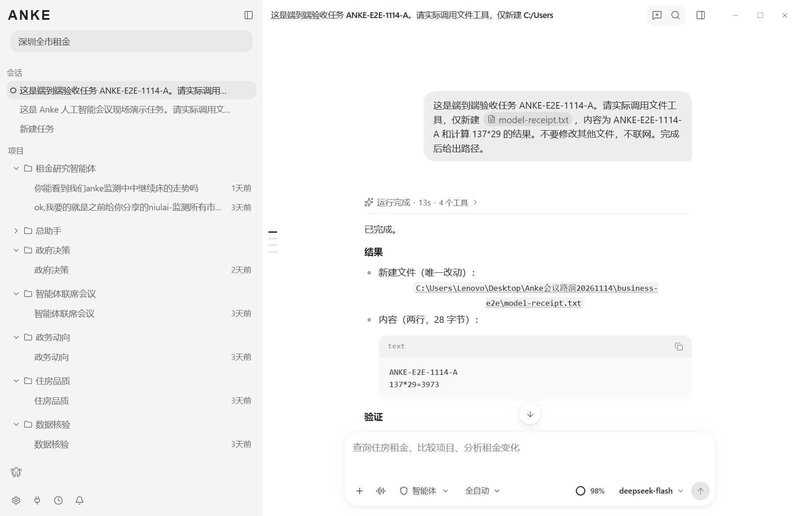
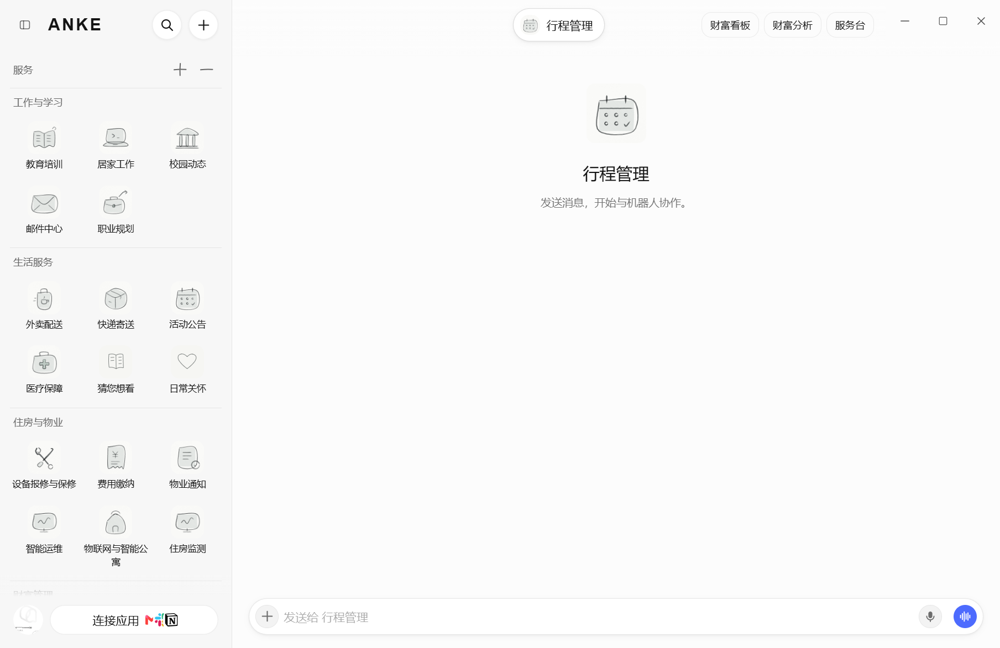

<p align="center">
  
</p>

<h1 align="center">ANKE · 安客</h1>

简体中文 | [English](README.md)

**您身边的私人生活与工作助理**——以本地桌面工作区连接住房服务、租金研究、日常事务、终身学习与 AI 助手。

科技服务生活，生活高于科技。在复杂中建立判断，在变化中安顿生活。我们希望 ANKE 帮助您看清选择、找到依据，再由您决定下一步。

ANKE 的项目入口为 [sjkncs/Anke](https://github.com/sjkncs/Anke)。

[](LICENSE)
[](https://www.typescriptlang.org/)
[](https://www.rust-lang.org/)
[](https://github.com/sjkncs/Anke/releases/tag/anke-2026.11.15-preview)

<p align="center">
  <a href="https://github.com/sjkncs/Anke/releases/tag/anke-2026.11.15-preview"><strong>下载预览资源</strong></a> &nbsp;·&nbsp;
  <a href="https://github.com/sjkncs/Anke/tree/6b1b539/anke-website"><strong>官网与体验</strong></a> &nbsp;·&nbsp;
  <a href="https://github.com/sjkncs/Anke/tree/6b1b539/config/local-presets"><strong>Bot 与模型配置</strong></a>
</p>

<p align="center">
  <a href="docs/spec/06-delivery/anke-releases-and-cloud.md"><strong>项目文档</strong></a> &nbsp;·&nbsp;
  <a href="https://github.com/sjkncs/Anke/releases"><strong>版本发布</strong></a> &nbsp;·&nbsp;
  <a href="CONTRIBUTING.md"><strong>参与贡献</strong></a>
</p>



*ANKE Agent 本地预览界面。下载资源需具备此私有仓库的访问权限。*

## 使用方式

| 入口 | 获取方式 | 说明 |
| --- | --- | --- |
| 桌面应用源码 | Electron、React 与 Rust Host 源码构建 | [快速开始](#快速开始) |
| 最新本地快照 | [2026.11.15 预览版](https://github.com/sjkncs/Anke/releases/tag/anke-2026.11.15-preview)，提交 `6b1b539` | [验证记录](https://github.com/sjkncs/Anke/blob/6b1b539/config/local-presets/VALIDATION.md) |
| 官网体验资源 | `ANKE-website-20261115.zip` | [官网源码](https://github.com/sjkncs/Anke/tree/6b1b539/anke-website) |
| Bot 与工作区配置 | `ANKE-presets-sanitized-20261115.zip` | [恢复限制](https://github.com/sjkncs/Anke/blob/6b1b539/config/local-presets/README.md) |
| 住房配套服务 | 仓库中的本地服务 | [住房服务](talent-housing/README.md) · [租金知识库](rent-knowledge/README.md) |
| 路演视频 | `ANKE-roadshow-20261115.zip`，视频及字幕 | [发布附件](https://github.com/sjkncs/Anke/releases/tag/anke-2026.11.15-preview) |

当前预览版提供源码与分包资源，**尚不包含 Windows EXE 安装包**。目前不承诺已发布的 ANKE npm 包、公开在线应用或公开 ANKE MCP 地址。下载需要仓库访问权限。



---

## 主要功能

- **私人助手与协作**：Bot 角色、指令、模型绑定、协作房间和工作区。
- **人才住房选择**：政府与高校房源、候选人偏好、项目对比及申请与工单工作流。
- **租金研究与证据**：带来源的记录、筛选、比较、情景测算和空间工具，挂牌与成交分别呈现。
- **资讯与政策阅读**：登记来源、事件快照及可追溯的原文阅读。
- **财富工作区**：最新快照包含金融数据和可视化模块，外部访问受账号权益与凭证限制。
- **工作与日常生活**：最新快照包含分类服务、终身学习与科研、修身养性、购物旅游工作区。
- **模型与连接器**：模型目录、模型选择与单独授权的服务连接。
- **本地优先**：桌面界面、原生持久化和智能体运行时保持独立进程边界。

[最新快照](https://github.com/sjkncs/Anke/tree/6b1b539)中的部分新增内容尚未合并到 `main`。源码存在、页面可见与外部任务执行成功是不同状态，请结合[支持状态](#支持状态)判断。

---

## 支持状态

| 入口 | 当前状态 | 边界 |
| --- | --- | --- |
| `main` | 源码基线 | 首页说明所在分支，尚非完整最新本地快照 |
| `anke-2026.11.15-preview` | 已发布预览版 | 源码、脱敏配置、官网及视频，固定到 `6b1b539` |
| Windows / macOS / Linux 安装包 | 本次未提供 | 继承的构建目标不等于已发布软件或跨机器验收 |
| 配置恢复 | 仅快照备份 | 38 个 Bot、5 个房间、10 个工作区、2 个模型服务、15 个模型条目；尚无自动导入器 |
| 模型、数据与点单连接器 | 需配置与实测 | 不含密钥；包含瑞幸、麦当劳 Bot HTTP 配置；独立 MCP 服务器文件为 0 |
| 完整应用验收 | 尚未完成 | 针对性检查已有结果，租金样例与格式检查有记录在案的失败项 |

Bot、附件和流式输出测试 **25/25 通过**；加入租金测试后 **29/34 通过**，其中 5 项依赖仓库未提供的演示记录。详见[验证记录](https://github.com/sjkncs/Anke/blob/6b1b539/config/local-presets/VALIDATION.md)。这些结果不代表外部 API 或跨机器运行已通过验收。

---

## 快速开始

**下载预览资源**：在[发布页](https://github.com/sjkncs/Anke/releases/tag/anke-2026.11.15-preview)分别下载所需文件，以 `SHA256SUMS.txt` 核对。配置包为备份格式，请勿直接覆盖运行数据库或 `team.json`；接收者需填写自己的有效凭证与本地路径。

**本地开发**：建议 Node.js 24，清单最低要求为 22.19.0；使用 `package.json` 固定的 pnpm 版本、Rust stable 及 Electron/原生依赖所需的平台工具。安装包含依赖构建钩子，请先核对清单。

```sh
git clone https://github.com/sjkncs/Anke.git
cd Anke
git switch --detach anke-2026.11.15-preview
pnpm install --frozen-lockfile
pnpm build:js
pnpm build:host
pnpm dev
```

标签选择最新已发布快照；省略此步骤将进入较早的 `main` 基线。这是开发步骤，尚非已验收的一键安装流程。

可选服务使用独立环境，请先阅读各服务 README，核对数据权限及服务商要求：

```sh
npm --prefix rent-knowledge ci
node talent-housing/server.mjs
python event-monitor/monitor.py --serve
```

在标签源码中运行 `node anke-website/serve.cjs`，打开 `http://127.0.0.1:47845` 查看官网。独立官网资源包包含路演视频，源码快照未打包视频。本地预览服务不等于生产部署。

---

## 技术栈

| 层次 | 技术 |
| --- | --- |
| 前端 | TypeScript、React、Vite 与共享桌面样式 |
| 桌面 | Electron、原生系统集成与 Rust Host |
| 智能体运行时 | Node.js/TypeScript 独立进程、模型适配器、插件 SDK 与开发工具 |
| 本地存储 | SQLite、Host 管理的持久化与凭证边界 |
| 住房数据 | Node.js/Python 工具、PostgreSQL/PGlite 及可选空间依赖 |
| 官网 | HTML、CSS、JavaScript 与独立媒体包 |
| 验证 | pnpm 工作区、Cargo、Node 测试与桌面端到端脚本 |

源码目录：[`apps/desktop`](apps/desktop)、[`packages`](packages)、[`crates/host-core`](crates/host-core)、[`rent-knowledge`](rent-knowledge)、[`event-monitor`](event-monitor)、[`talent-housing`](talent-housing)、[`scripts`](scripts) 与 [`docs`](docs)。

---

## 编程接入

- **插件 SDK 与工具**：[`plugin-sdk`](packages/plugin-sdk)、[`plugin-devkit`](packages/plugin-devkit) 和[插件约定](docs/spec/07-plugins)，遵循权限及 Host 接口边界。
- **本地住房服务**：[住房工作台](talent-housing/README.md)与[租金知识库](rent-knowledge/README.md)，分别按自身说明配置。
- **模型服务**：在应用中配置账号，快照保留模型绑定但不含密钥。
- **MCP 与 Bot 连接器**：分别授权。瑞幸与麦当劳的 Bot HTTP 配置不代表已部署公开 ANKE MCP 服务，也不代表点单、支付实测成功。

发布包不分发维护者令牌、私人 OAuth 会话或个人 API 余额。配置存在不等于认证成功、额度可用或操作已有回执。

---

## 住房数据

我们将候选人需求、可供房源、周边环境与租金证据联系起来；研究住房质量调整后的租金时，分别处理住房特征、家庭支付能力及政策资格。

经纬度、建筑轮廓、道路、遥感及街景分割均需记录来源、日期、坐标系统与核验结果。单张叠加图或模型输出不能直接证明结构安全、入学资格、实时拥堵或已核实的质量缺陷。

仓库自带租金记录为空，不包含原始数据库、受限影像、模型权重和研究档案。参见[数据边界](rent-knowledge/README.md)。

---

## 项目支持

ANKE 的建设受益于开源社区及其依赖生态。组件来源与署名见[改造说明](ANJU_SOURCE_NOTES.md)、[许可证](LICENSE)和插件声明。目前不宣称已获得商业赞助、托管赞助或第三方背书。

---

## 数据来源

| 来源类别 | 用途 | 使用边界 |
| --- | --- | --- |
| 住房政策与通知 | 资格说明、可追溯咨询 | 核对版本与生效时间，不代替行政审批 |
| 获准使用的租金观察 | 可比租金与项目分析 | 挂牌、成交、指导价与公共住房租金分别处理 |
| 已登记新闻来源 | 事件与政策阅读 | 可访问性和时效各异，采集不等于效果已证实 |
| Findesk 等金融数据 | 财富研究与图表 | 受用户凭证、套餐权益、额度及上游可用性约束 |
| 空间与影像数据 | 环境分析与分割 | 需核对许可、配准、影像日期并独立验证 |
| 用户自备知识 | 本地检索与科研工作流 | 私人资料与账号不随包分发 |

缺失信息保持缺失。可访问不等于可再分发，也不等于历史完整或实时覆盖。

---

## 参与贡献

阅读 [CONTRIBUTING.md](CONTRIBUTING.md) 与 [AGENTS.md](AGENTS.md)，保持改动范围清晰，保护用户数据并提供可复核检查。私有仓库需先获得访问权限。

```sh
pnpm --filter @pi-desktop/desktop typecheck
node --test apps/desktop/test/anke-release-config.test.mjs
```

这些是现有命令，不代表本次文档变更运行了完整应用测试。另见[基线验证节点](docs/spec/06-delivery/anke-verification-2026-11-12.md)与[发布/云服务约定](docs/spec/06-delivery/anke-releases-and-cloud.md)。

---

## 许可证

桌面基线为 **LGPL-3.0-or-later**，完整条款见 [LICENSE](LICENSE)，来源见[改造说明](ANJU_SOURCE_NOTES.md)。内置 Bot 保留 **Apache-2.0** 条款。依赖、插件、媒体和数据分别遵循各自许可。

| 使用情形 | 适用要求 |
| --- | --- |
| 个人、科研与教育 | 遵守对应代码和数据许可 |
| 修改与再分发 | 保留声明，履行适用的源码及分发义务 |
| 商业部署 | 逐项核对 LGPL 与组件条款，此处不授予统一闭源许可 |
| 凭证、私人记录与第三方数据 | 不由代码许可授权，须另行取得权限 |
| ANKE 与上游品牌 | 源码可用不自动授予商标或背书权利 |

---

## 作者

**ANKE 项目维护者**：[sjkncs](https://github.com/sjkncs)。

## 贡献者

参见[仓库贡献记录](https://github.com/sjkncs/Anke/graphs/contributors)与组件声明。源码快照不代表重构了上游贡献历史。

## 安全致谢

安全问题请参照 [SECURITY.md](SECURITY.md) 报告，不要提交 API 密钥、Cookie、个人数据库或私人住房记录。本页不列未经核实的外部安全致谢名单。

---

<p align="center">
  <a href="https://github.com/sjkncs/Anke">ANKE</a> &nbsp;·&nbsp;
  <a href="https://github.com/sjkncs/Anke/releases">版本发布</a> &nbsp;·&nbsp;
  <a href="README.md">English</a> &nbsp;·&nbsp;
  <a href="https://github.com/sjkncs/Anke/tree/6b1b539/anke-website">官网源码</a>
</p>

## Star History

[查看仓库动态](https://github.com/sjkncs/Anke/activity)。仓库为私有，不嵌入需要公开访问的第三方星标历史图，也不编造数量或趋势。
